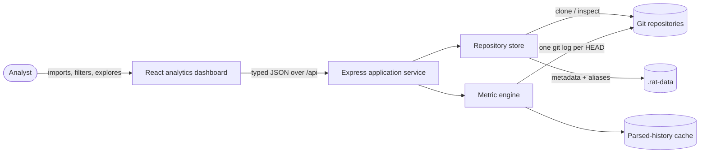
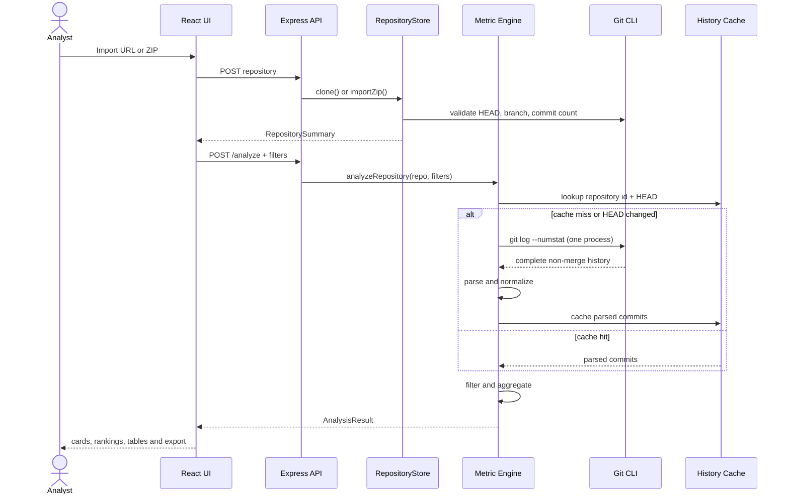
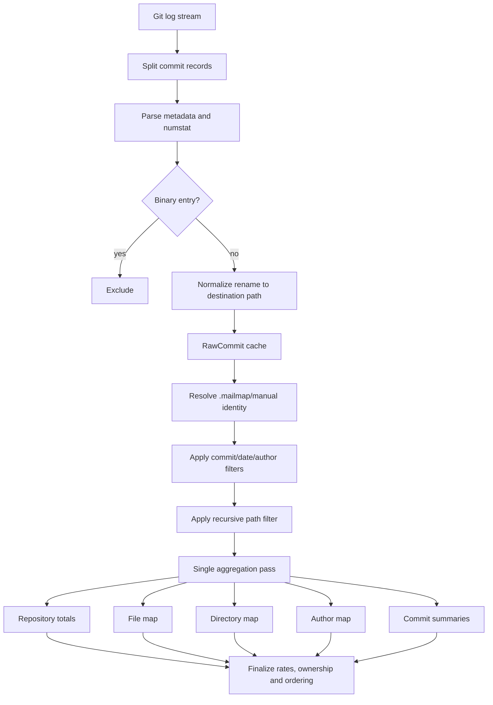
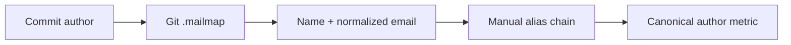

# RAT Architecture and Metric Computation

> Design goal: turn a complete Git history into trustworthy, interactive metrics with one history extraction per repository revision and predictable in-memory aggregation.

## 1. Architectural vision

RAT is designed as a small, cohesive analytics system rather than a collection of scripts. Git remains the source of truth, the server owns computation and repository lifecycle, and the browser receives a stable, typed analysis model that it can visualize without reproducing domain logic.

The architecture optimizes for four qualities:

1. **Correctness** — calculations follow the assessment definitions and preserve commit, path, rename, and author semantics.
2. **Efficiency** — history is extracted once for each `HEAD`, parsed once, cached, and reused across filter combinations.
3. **Explainability** — every displayed value can be traced from a commit, through a file change, into an aggregate.
4. **Operational simplicity** — one npm package and one start command run the API, analytics engine, persistence, and production UI.

## 2. Why these technologies

Technology choices were driven by the assessment's need for reliable Git processing, an interactive analytical interface, simple setup and code that can be evaluated quickly.

| Technology | Why it was selected | Alternative considered and trade-off |
|---|---|---|
| **TypeScript** | One language and one type system span the API, metric engine and browser. Shared result/filter interfaces catch contract drift at build time and make metric definitions explicit. | Plain JavaScript would reduce configuration but lose compile-time guarantees around metric shapes and filters. |
| **Node.js** | It has mature process, filesystem and streaming primitives for orchestrating Git while also running the web API. This avoids a second backend language and keeps the submission easy to install. | Python has strong data tooling, but would introduce a second package ecosystem and duplicate cross-layer models. |
| **Express 5** | Its small middleware model suits RAT's focused REST surface, upload handling and static production hosting without imposing a larger application framework. | NestJS would add dependency injection and structure, but that overhead is unnecessary for seven routes and one local service. |
| **React 19** | Repository switching, filters, modals and tabbed views are naturally state-driven. Reusable components keep metric presentation consistent as analysis results change. | Server-rendered templates would simplify delivery but make interactive re-filtering and multi-view state more cumbersome. |
| **Vite** | It provides a fast development loop, optimized production assets and a simple `/api` development proxy, while retaining a conventional React build. | A heavier full-stack framework would duplicate Express responsibilities and obscure the metric engine behind framework conventions. |
| **Git CLI** | Git itself is the authoritative implementation of history traversal, `.mailmap`, rename similarity and `numstat`; reusing it is both more correct and more maintainable than reimplementing repository semantics. | A JavaScript Git library could avoid process execution, but often has incomplete rename/mailmap behavior and increases correctness risk. |
| **Local filesystem + JSON metadata** | The assessment needs a runnable single-machine tool. UUID-scoped repositories plus an atomically replaced index provide persistence with no database setup. | A relational database would improve concurrent multi-user operation, but adds infrastructure without improving local metric correctness. |
| **Node test runner** | It tests TypeScript through `tsx` with no separate test framework runtime and keeps dependency exposure low. | A larger test framework offers more UI-oriented utilities, but the core domain tests only need fixtures and assertions. |
| **Hand-authored CSS** | The visual system is small and distinctive; direct CSS gives precise control over responsive grids, semantic colors and density without shipping a component framework. | A UI kit would accelerate generic screens but make the dashboard less distinctive and increase bundle/dependency weight. |

### Why a client-server architecture

Git repositories, archive extraction and child processes require filesystem privileges and resource limits; they belong behind a server boundary. Visualization needs responsive state and fast interaction; it belongs in the browser. The typed HTTP boundary lets each side specialize while preventing unsafe Git operations from leaking into presentation code.

A monolithic desktop process was considered, but it would make installation and assessment harder. A fully client-side implementation was rejected because browsers cannot safely clone and inspect arbitrary full Git histories. The selected local web architecture offers desktop-like capability through a familiar URL and a single `./start.sh` command.

### Why precompute history but aggregate per request

Persisting every possible metric cube would make ingestion expensive and filters rigid. Re-running `git log` for every filter would make interaction slow. RAT therefore caches the stable, normalized history and a bounded set of filtered analysis snapshots. Page and search requests reuse those snapshots without repeating Git I/O or aggregation. This is the architectural midpoint that preserves flexible commit sets while keeping navigation responsive.

## 3. System context



The browser is deliberately separated from Git execution. This creates a clear trust boundary: paths, archives, processes, and long-running analysis remain server-side, while presentation and interaction remain client-side.

## 4. Component architecture

| Layer | Responsibility | Key implementation |
|---|---|---|
| Presentation | Repository selection, filters, metric cards, charts, tables, export, progress and errors | `src/App.tsx`, `src/styles.css` |
| API client | Typed transport and consistent error handling | `src/api.ts` |
| Shared contract | Compile-time agreement for filters, results, metrics and repository summaries | `shared/types.ts` |
| Application API | Route orchestration, validation, upload limits and production asset serving | `server/index.ts` |
| Metric engine | History extraction, parsing, filtering, identity resolution and aggregation | `server/metrics.ts` |
| Repository store | Clone/ZIP ingestion, repository validation, metadata, aliases and deletion | `server/repository-store.ts` |
| Persistence | Managed Git repositories and atomic JSON metadata index | `.rat-data/` |

This separation keeps the metric engine independent of HTTP and React. It can therefore be tested directly with deterministic Git fixtures.

## 5. End-to-end data flow



### Why one history command matters

Launching a Git process per commit, file, or metric would multiply I/O and process overhead. RAT asks Git for all required commit metadata and `numstat` changes in one command:

```text
git log HEAD --no-merges --date-order --use-mailmap \
  --find-renames=50% \
  --format=<record-and-field-delimited-header> --numstat
```

The result contains enough information to derive every required metric category without revisiting Git. Stdout is parsed incrementally as commit delimiters arrive, avoiding a second whole-history string and removing fixed child-process output-buffer limits.

## 6. Metric model

For a selected commit set `H` and an object `o`:

| Metric | Definition |
|---|---|
| Added | `Σ added lines` attributed to `o` |
| Removed | `Σ removed lines` attributed to `o` |
| Growth | `added − removed` |
| Churn | `added + removed` |
| Modifications | number of selected commits that modify `o` |
| Modification frequency | `modifications / |H|` |
| Churn rate | `churn / |H|` |
| Author ownership | `author churn / total selected churn` |

The same primitive change event feeds five perspectives:

- **Repository** — all relevant file changes in `H`.
- **File** — changes grouped by normalized post-rename path.
- **Directory** — changes propagated to every ancestor directory, including repository root `.`.
- **Commit set** — any subset produced by author, date, path, or explicit commit selection.
- **Author** — changes grouped by canonical `Name <email>` identity.

This shared model prevents category drift: repository totals, file rows, directory rows and author rows are different projections of the same selected change stream.

## 7. Computation pipeline



### 7.1 Parse once

Custom record (`0x1e`) and field (`0x1f`) delimiters avoid ambiguous parsing of ordinary commit subjects. Binary `numstat` rows use `-` values and are excluded because line-based metrics are undefined for binary content.

### 7.2 Rename-aware paths

`--find-renames=50%` delegates similarity detection to Git. Both braced (`src/{old => new}/x.ts`) and plain (`old => new`) forms are normalized to the destination path, so work follows the current file identity.

### 7.3 Commit-set filtering

Date, author and explicit-hash filters first select commits. Path filtering then selects changes within each selected commit. All dimensions compose with **AND** semantics, making the displayed analysis scope reproducible.

### 7.4 Single-pass multidimensional aggregation

During one pass over selected changes, RAT updates repository totals, file metrics, per-commit directory accumulators, author metrics and commit summaries. JavaScript `Map` and `Set` structures provide expected constant-time lookups.

A per-commit directory map is an important correctness detail. It sums all child-file changes for a directory before incrementing that directory's modification count, ensuring that a directory modified in one commit is counted once even when many descendant files changed.

### 7.5 Derived values are finalized once

Frequency, rate and ownership are calculated after aggregation. This keeps additive values integral during the hot loop and centralizes zero-denominator handling.

## 8. Complexity analysis

Let:

- `C` = number of non-merge commits,
- `F` = total text-file change records across those commits,
- `D` = average path depth,
- `O` = number of resulting file, directory and author objects.

| Stage | Time | Additional space |
|---|---:|---:|
| Git extraction and parsing on cache miss | `O(C + F)` | `O(C + F)` |
| Commit/author/date filtering | `O(C)` expected | `O(C)` selected references |
| File and recursive directory aggregation | `O(F_selected × D)` | `O(O)` |
| Availability metadata indexing | `O(C + F × D)` once per `HEAD` | `O(O)` |
| Result ordering | `O(O log O)` | `O(O)` |
| Cached page materialization | `O(O)` search + `O(pageSize)` slice | bounded response |

For ordinary source trees, `D` is small and bounded, so the dominant first-pass work is effectively linear in history size plus output sorting. Subsequent analyses at the same `HEAD` avoid Git execution and parsing; page navigation also reuses a filter-aware snapshot. API pages are clamped to at most 250 rows.

### Cache invariant

```text
cache entry is reusable ⇔ cached.repositoryId = request.repositoryId
                          ∧ cached.head = repository.head
```

A changed `HEAD` invalidates reuse naturally. A second LRU key includes canonicalized filters and aliases but excludes page/search controls, allowing navigation to reuse aggregation. Both caches default to two entries, preventing unbounded growth across large repositories and filter combinations.

## 9. Identity architecture

Identity is represented by the complete `Name <email>` pair. This intentionally preserves distinct historical identities until normalization is explicit.

Normalization has two layers:

1. Git applies repository-owned `.mailmap` rules through `--use-mailmap`.
2. RAT applies persisted manual aliases, resolving alias chains transitively with cycle protection.



This design respects repository policy while giving analysts a reversible correction mechanism for identities not covered by `.mailmap`.

## 10. Ingestion and persistence

### URL ingestion

- Accepts public `http://`, `https://` and `git://` clone URLs.
- Uses `execFile`, so arguments are passed without shell interpolation.
- Performs a full, non-single-branch clone into a UUID-scoped managed directory.
- Applies process timeout and output-buffer limits.

### ZIP ingestion

- Limits upload size and file count at the HTTP boundary.
- Rejects absolute paths and `..` traversal segments.
- Verifies each resolved extraction target remains inside its destination.
- Searches to bounded depth for a **literal child `.git` entry**.
- Never uses parent-walking `git rev-parse` for root discovery, preventing an uploaded archive from being mistaken for an enclosing repository.

### Durable metadata

Repositories live under `.rat-data/repositories/<uuid>/`. Summaries and manual aliases are written to `repositories.json` through temporary-file-plus-rename replacement, reducing the risk of a partially written index.

## 11. API design

| Method and route | Purpose |
|---|---|
| `GET /api/health` | Runtime readiness |
| `GET /api/repositories` | List managed repositories |
| `POST /api/repositories/clone` | Import a public Git URL |
| `POST /api/repositories/upload` | Import a repository ZIP |
| `POST /api/repositories/:id/analyze` | Compute an optionally filtered analysis |
| `PUT /api/repositories/:id/aliases` | Persist manual author mappings |
| `DELETE /api/repositories/:id` | Remove a managed repository |

Analysis uses `POST` because the filter can contain a potentially large commit set and is naturally represented as structured JSON. Shared TypeScript interfaces make the response contract explicit across server and client.

## 12. Architectural decisions and trade-offs

| Decision | Benefit | Trade-off |
|---|---|---|
| Git CLI as history authority | Correct rename, mailmap and traversal semantics | Requires Git at runtime |
| One complete history extraction | Minimal process overhead; all metrics share one source | Initial import analysis scales with full history |
| Bounded history and analysis LRU caches | Fast repeated filtering/navigation without unbounded cache growth | Cache is lost on restart and consumes controlled process memory |
| Local filesystem persistence | Zero external infrastructure; simple assessment startup | A single node owns state |
| Server-side aggregation | One canonical metric implementation | Filter changes require an API round trip |
| Full identity pair as key | Matches reference semantics and avoids accidental merges | Human variants remain separate until mapped |
| Server-side search and pagination | Bounded JSON and DOM work; every commit remains reachable | Page changes use lightweight API requests |

These choices are intentional for a local analysis tool. If RAT evolved into a multi-user service, the natural next steps would be a persistent parsed-history store, background analysis jobs, streamed progress and shared object storage.

## 13. Correctness and verification evidence

The architecture is supported by executable tests and reference-data checks:

- Git-log parsing verifies rename normalization and binary exclusion.
- Aggregation tests cover repository, file and recursive-directory metrics.
- Filtering tests cover author selection.
- Identity tests cover manual author merging.
- Pagination/search tests verify bounded pages and result counts.
- An always-on synthetic 100,000-commit test verifies exact totals, 250-row paging, a serialized response below 1 MB and completion under a conservative 15-second threshold; repeated local runs completed the analysis in approximately 0.7 seconds.
- The cJSON reference revision matched the supplied CSV for representative values in every required category, including exact repository totals, file metrics, directory metrics and author ownership.
- URL clone and ZIP ingestion were exercised end to end.
- The production TypeScript/Vite build and dependency audit pass.

The most important reference result is consistency: cJSON repository totals were `46,377` added, `11,211` removed, `35,166` growth, `57,588` churn and `953` modifications across `955` non-merge commits, exactly matching the supplied assessment data.

## 14. Code map for assessors

| Concern | Evidence |
|---|---|
| Streamed history extraction and bounded caches | `server/metrics.ts` — `streamGitHistory`, `loadHistory`, `remember` |
| Server-side pagination and search | `server/metrics.ts` — `pageItems`, `materializeResult` |
| Robust parser and rename handling | `server/metrics.ts` — `parseGitLog`, `resolveRename` |
| Recursive directory algorithm | `server/metrics.ts` — `directoryAncestors`, aggregation loop |
| Filter and commit-set semantics | `server/metrics.ts` — `analyzeRepository` |
| Author canonicalization | `server/metrics.ts` — `identityKey`, `canonicalKey` |
| Secure ingestion and persistence | `server/repository-store.ts` |
| HTTP orchestration | `server/index.ts` |
| End-to-end type contract | `shared/types.ts` |
| Metric tests | `server/metrics.test.ts` |
| Dashboard presentation | `src/App.tsx`, `src/styles.css` |

## 15. Architecture summary

RAT's central architectural idea is **extract once, interpret many times**. A single Git history stream is normalized into a reusable commit model; a single aggregation pass projects that model into all rubric categories; a typed API then exposes those projections to an interface optimized for progressive insight. The result is efficient enough for interactive filtering, simple enough to run with one command, and transparent enough for every number to be explained.