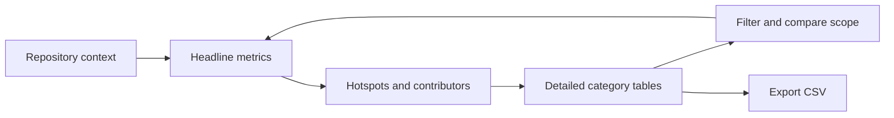
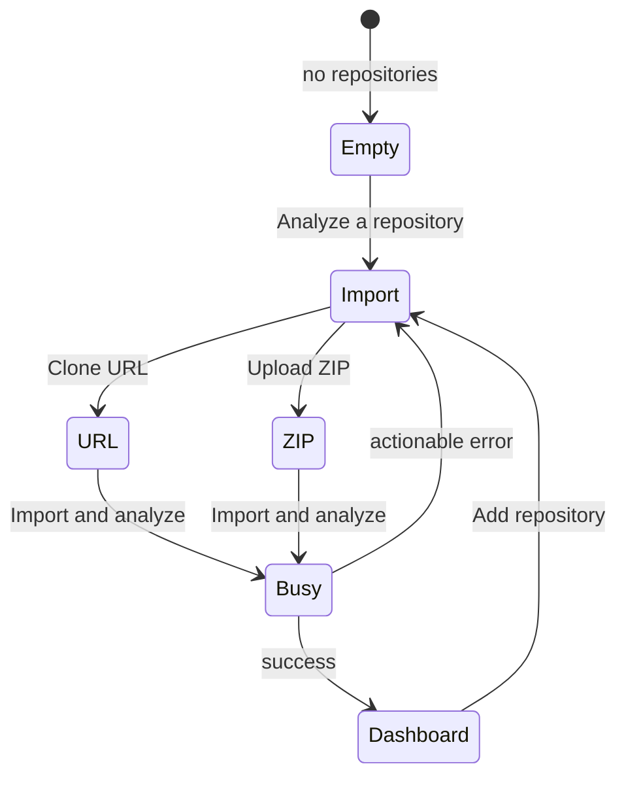

# RAT UI and Visualization Design

> Design goal: make a large Git history understandable in seconds, explorable in minutes, and auditable down to individual commits.

## 1. Experience concept

RAT is presented as a focused **repository intelligence console**. Its visual language borrows from professional observability and engineering tools: dense enough for serious analysis, but organized around a strong hierarchy so the first screen never feels like a spreadsheet.

The experience follows progressive disclosure:

1. **Orient** — identify the repository, revision and selected scope.
2. **Scan** — read the five headline measures.
3. **Discover** — spot volatile files and influential contributors.
4. **Investigate** — move into complete file, directory, author or commit tables.
5. **Refine** — constrain the commit set with composable filters.
6. **Act** — merge identities or export evidence as CSV.



## 2. Why this UI direction

The interface is intentionally a dashboard rather than a report generator or step-by-step wizard. Repository analysis is exploratory: users notice a hotspot, inspect its rows, narrow the scope, and repeat. Keeping context, summaries, rankings and details in one workspace supports that loop without repeated navigation.

| Design choice | Why it was chosen | Alternative considered and trade-off |
|---|---|---|
| **Dark engineering-console theme** | Long analytical sessions benefit from a low-glare canvas, and restrained luminous accents create a distinctive repository-intelligence identity. | A generic light admin theme would be familiar but visually undifferentiated and less suited to dense code-oriented data. |
| **Overview first, details below** | Users can understand direction and scale before reading individual rows; the same page still supports audit-level inspection. | A table-first interface exposes every number immediately but hides the larger story and increases cognitive load. |
| **Five semantic metric cards** | Added, removed, growth, churn and modifications remain conceptually separate and can be scanned in a stable sequence. | Combining metrics into one chart would save space but blur important distinctions such as growth versus activity. |
| **Horizontal ranked bars** | File paths and author names fit naturally beside horizontal marks, while a shared baseline makes hotspot magnitude easy to compare. | Pie/donut charts are poor for close comparisons and imply part-to-whole relationships that do not apply to file churn rankings. |
| **Exact tables beneath charts** | Visual summaries generate hypotheses; tables expose the exact evidence needed to verify them. | Chart-only presentation would look lighter but weaken traceability and assessment confidence. |
| **Tabs by analytical object** | Files, directories, authors and commits have different schemas; tabs preserve focus while retaining a consistent workspace. | Separate pages would create more navigation and make switching perspectives slower. |
| **Persistent repository rail** | Multi-repository analysis is a primary requirement, so repositories remain visible and switching costs one action. | A repository dropdown uses less space but hides available context and commit counts. |
| **Collapsible filter workspace** | Filters are powerful but secondary during initial scanning. Revealing them on demand protects the overview while keeping scope controls close. | Permanently visible filters would reduce chart space; a separate filter page would break the exploration loop. |
| **Modal ingestion and identity merge** | These are short, focused workflows that temporarily require full attention and return users to the same analysis context. | Dedicated pages would overstate their importance and disrupt continuity. |
| **Custom CSS instead of a chart/UI library** | The required visualizations are compact, accessible HTML/CSS primitives. Avoiding a large library keeps the look original, the bundle smaller and exact values easy to expose. | A chart library would add richer chart types, but also dependency weight and visual complexity not justified by the questions being answered. |

### Why these visualizations fit the data

RAT's primary measures are totals, rankings and detailed records—not continuous time series. Cards are strongest for totals, common-baseline bars are strongest for rankings, and tables are strongest for exact multidimensional records. This matching of data shape to visual form avoids decorative charts that look impressive but answer the wrong question.

The overview and evidence layers also share the same churn ordering. A hotspot seen in a bar chart appears at the top of the file table, so the transition from discovery to investigation is predictable.

## 3. User goals

The interface is designed around practical engineering questions:

| User question | UI answer |
|---|---|
| Is the codebase growing or being simplified? | Added, removed and net-growth cards |
| Where is maintenance effort concentrated? | Churn-ranked hotspot bars and file table |
| Which subsystem changes most often? | Recursive directory table |
| Who has the greatest impact or ownership? | Contributor-impact chart and ownership bars |
| What happened in a particular period or set of commits? | Date and explicit commit-set filters |
| Are duplicate identities distorting ownership? | `.mailmap` support and Merge Authors workflow |
| Can I inspect or grade the numbers elsewhere? | CSV export for every detail view |

## 4. Information architecture

```text
┌─ Persistent repository rail ─┬─ Repository / branch / HEAD context ───────────┐
│                              │  Merge authors   Filters   Remove              │
│  Repository A                ├─────────────────────────────────────────────────┤
│  Repository B                │  ANALYSIS SCOPE · selected / total commits     │
│  Repository C                ├─────────────────────────────────────────────────┤
│                              │  +Added  −Removed  Growth  Churn  Modifications │
│  + Add repository            ├──────────────────────────┬──────────────────────┤
│                              │  Top hotspots            │ Contributor impact   │
│  Git engine ready            ├──────────────────────────┴──────────────────────┤
│                              │  Files · Directories · Authors · Commits · CSV  │
└──────────────────────────────┴─────────────────────────────────────────────────┘
```

The fixed repository rail supports rapid context switching across multiple imports. The main canvas remains consistent between repositories, reducing relearning and making comparisons easier.

## 5. Visual hierarchy

The dashboard uses four deliberate levels of emphasis:

### Level 1 — repository identity

The title, branch and short `HEAD` hash establish exactly what is being analyzed. This is essential for trustworthy metrics: the same repository name at another revision can produce different results.

### Level 2 — analysis scope

A compact scope line shows selected commits against total commits and the generation time. When filters are active, the filter button displays a visible count. This prevents analysts from reading filtered numbers as whole-repository totals.

### Level 3 — headline metrics

Five cards form a consistent left-to-right narrative:

1. lines introduced,
2. lines removed,
3. net direction,
4. total activity,
5. frequency of change.

Each card combines a large monospace number with a short explanatory secondary value. This balances rapid scanning with metric meaning.

### Level 4 — evidence and detail

Ranked insight panels provide immediate leads; tabbed tables provide complete evidence. This preserves a clean overview without hiding the underlying data.

## 6. Visualization system

### 6.1 Semantic metric palette

| Color token | Meaning | Usage |
|---|---|---|
| Green `#63e6a5` | Addition, active/success state | Added lines, primary action, active repository |
| Red `#ff7b88` | Removal or destructive action | Removed lines, delete affordance |
| Blue `#64b5ff` | Directional balance | Net growth, commit hashes |
| Amber `#ffc15c` | Volatility and attention | Churn |
| Violet `#b69cff` | Change incidence and ownership | Modifications, contributor impact |

Color is reinforced by labels, signs (`+`/`−`), placement and text, so meaning is not dependent on hue alone.

### 6.2 Metric cards

Cards use consistent geometry and typography, allowing values to be compared without visual noise. A restrained glow and corner accent give each metric an identity while preserving a professional engineering aesthetic.

The numbers use **DM Mono**, making digits stable and scannable. Interface copy uses **Manrope**, which remains readable at compact dashboard sizes.

### 6.3 Hotspot ranking

The six highest-churn files are shown as normalized horizontal bars:

```text
bar width = item churn / maximum visible churn × 100%
```

Horizontal bars suit long file paths and make rank and magnitude immediately apparent. The exact churn value remains visible, avoiding the precision loss common in chart-only dashboards. A two-percent minimum keeps very small non-zero values discoverable.

### 6.4 Contributor impact

Authors use the same visual grammar as hotspots but a violet scale, establishing that both panels measure churn while keeping “place” and “person” conceptually distinct.

### 6.5 Ownership bars

The Authors table embeds ownership bars with a percentage label. The fill supports pre-attentive comparison; the number supports exact interpretation. Ownership is based on churn share, so the visualization communicates contribution impact rather than simply commit count.

### 6.6 Analytical tables

Tables are the audit layer of the product:

- sticky headers preserve metric meaning while scrolling;
- compact rows maximize useful information density;
- positive and negative values use semantic styling;
- long paths and subjects truncate visually but retain full hover text;
- commit hashes use monospace styling;
- files and directories have distinct icons;
- bounded vertical scrolling keeps the page structure stable;
- server-side search narrows each object type without loading every row;
- first/previous/next/last controls expose the user's exact position;
- selectable 50, 100 or 250-row pages cap browser rendering work.

The four tabs mirror the required metric categories while avoiding an overwhelming all-in-one table. Their count badges report the full or searched result count, not merely the visible page.

## 7. Interaction design

### Repository ingestion



The empty state explains the product's value before requesting input. URL and ZIP options share one segmented modal, minimizing decision overhead. Busy controls are disabled and progress copy says what the system is doing.

### Filtering

The filter panel is collapsible because filtering is important but not always needed. It presents date, author, object and explicit commits in one row on large screens, visually communicating that dimensions can be combined.

Draft and active filter state are separate. A user can prepare a scope without continuously triggering expensive analysis; **Apply** commits the change, while **Reset** restores the full repository.

The path control accepts direct text with bounded suggestions, so tens of thousands of paths never become an enormous DOM select. Commit selection accepts comma- or whitespace-separated SHA prefixes, making every commit addressable without presenting 100,000 options.

Date handling uses inclusive calendar-day behavior in the UI: the selected “Until” date is converted to the next midnight and treated as an exclusive server boundary.

### Author identity management

The Merge Authors dialog names the operation in domain language:

- choose an alias identity;
- choose its canonical identity;
- persist the relationship;
- rerun analysis to update ownership and attribution.

The dialog also explains that `.mailmap` has already been applied, helping users understand the relationship between repository-defined and analyst-defined normalization.

### Feedback and recovery

| State | Design response |
|---|---|
| No repositories | Value-led onboarding with one primary action |
| Import/merge in progress | Disabled submit action and inline spinner |
| Initial analysis in progress | Centered “Walking Git history” state with contextual copy |
| Page/search refresh | Existing dashboard remains visible with inline “Updating view…” status |
| Empty filtered result | Local no-data copy inside the affected visualization |
| Request failure | High-contrast error banner near the active workflow |
| Destructive removal | Native confirmation before repository deletion |

## 8. Responsive behavior

The layout uses content-driven breakpoints rather than merely shrinking the desktop UI.

| Viewport | Adaptation |
|---|---|
| Above `1100px` | Five-card overview, two insight panels, full filter row |
| `761–1100px` | Three-column cards; filter controls reflow into three columns |
| `431–760px` | Repository rail becomes horizontal top navigation; cards become two columns; insight panels stack |
| `≤430px` | Single-column cards and filters; decorative onboarding metadata is removed |

Wide analytical tables retain their natural structure and become horizontally scrollable. This is preferable to collapsing columns and silently removing metrics. Pagination controls also become horizontally scrollable on narrow screens rather than wrapping into an unclear order.

## 9. Large-result usability

The browser never renders the whole result set. Each table receives a bounded server page, while summary cards and six-item insight charts remain stable above it. Search input is debounced by 250 ms, and page/search requests reuse the server's filtered-analysis cache.

Navigation preserves context during updates: the existing dashboard stays in place and an inline progress indicator appears. Request cancellation guards prevent a slower, stale response from replacing a newer user choice. This makes rapid tab, page and search interactions feel controlled even when the underlying repository contains approximately 100,000 commits.

For implementation and measured evidence, see [Usability and 100k-Commit Scale Design](USABILITY_AND_SCALE.md).

## 10. Accessibility-minded design

The current interface includes:

- semantic landmarks such as `main`, `aside`, `nav`, `header`, `section` and `article`;
- real buttons, inputs and selects with native keyboard behavior;
- explicit labels for form controls;
- ARIA labels for key icon-only controls;
- visible focus treatment on inputs and selects;
- status communicated with text in addition to animation or color;
- a `320px` minimum layout target;
- textual values alongside every visual bar.

Accessibility is treated as an ongoing quality dimension. A production hardening pass would add modal focus trapping, Escape-key dismissal, complete icon-button accessible names, reduced-motion support, formal contrast measurement and screen-reader announcements for asynchronous completion.

## 11. Visual design language

### Tone

The dark, low-glare canvas reflects the environment in which engineering analytics is commonly used. Panels are separated with subtle borders rather than heavy shadows. Saturated color is reserved for meaning and action.

### Geometry

- compact `8–11px` control and panel radii communicate precision;
- the onboarding emblem uses a larger radius and slight rotation to feel inviting;
- consistent ten-pixel panel gaps create rhythm across cards, charts and tables;
- a maximum dashboard width prevents metrics from becoming disconnected on very wide screens.

### Motion

Motion is intentionally minimal. Short hover transitions confirm interactivity, and spinner animation communicates progress. No decorative animation competes with analytical reading.

### Copy

Labels use concise domain language: **Volatility**, **Ownership**, **Analysis scope**, **Churn / commit**. Supporting copy explains consequences instead of exposing implementation details. The result feels specialized without requiring prior knowledge of the codebase.

## 12. Honest visual encoding

RAT avoids several common dashboard problems:

- Bars begin from a common zero baseline.
- Exact values accompany relative bars.
- Added and removed values are never merged into a signed “activity” number.
- Growth and churn are shown separately because they answer different questions.
- Ownership identifies its basis through the surrounding churn context.
- The selected/total commit count remains visible above all visualizations.
- Detailed rows remain available behind every summary.

This makes the interface attractive without sacrificing analytical integrity.

## 13. Design-to-code traceability

| Design element | Implementation evidence |
|---|---|
| Repository rail and context header | `App`, `app-shell`, `sidebar`, `topbar` |
| Headline hierarchy | `MetricCard`, `metrics-grid` |
| Hotspot and contributor bars | `BarList`, `insights-grid` |
| Detailed analytical views | `DataTable`, `tabs-row`, `table-wrap` |
| Large-result navigation | `table-toolbar`, `table-pagination`, `pages` |
| Composable scope controls | `FilterPanel`, `activeFilters` |
| URL/ZIP onboarding | `EmptyState`, `IngestModal` |
| Author normalization workflow | `MergeModal` |
| Evidence export | `exportCsv` |
| Responsive system | media queries in `src/styles.css` |
| Loading and error feedback | `loading-state`, `error-banner`, `spinner` |

## 14. Evaluation against the design criterion

### Efficient algorithms and architecture for metric computation

- one streamed Git history command per repository `HEAD`;
- bounded history and filtered-analysis LRU caches;
- server-side search and 25–250-row pagination;
- expected constant-time map/set aggregation;
- one selected-history pass computes all metric perspectives;
- per-commit directory deduplication preserves modification semantics;
- bounded commit-detail payload protects browser rendering;
- clear server/client/shared-contract separation.

### Inspired visualization of metrics

- a deliberate overview-to-evidence information hierarchy;
- semantic five-color metric language;
- ranked hotspot and contributor visualizations;
- embedded ownership bars paired with exact values;
- repository, scope and revision context always visible;
- responsive multi-repository workspace;
- domain-specific onboarding, loading, empty and error states;
- CSV escape hatch for independent assessment and deeper analysis.

## 15. UI design summary

RAT does not treat visualization as decoration. Each layer answers a progressively deeper question: **What changed? Where did it change? Who changed it? Which commits define the scope?** The interface turns metric computation into an investigative workflow, while consistent color, typography, hierarchy and interaction patterns give that workflow a distinctive and polished identity.