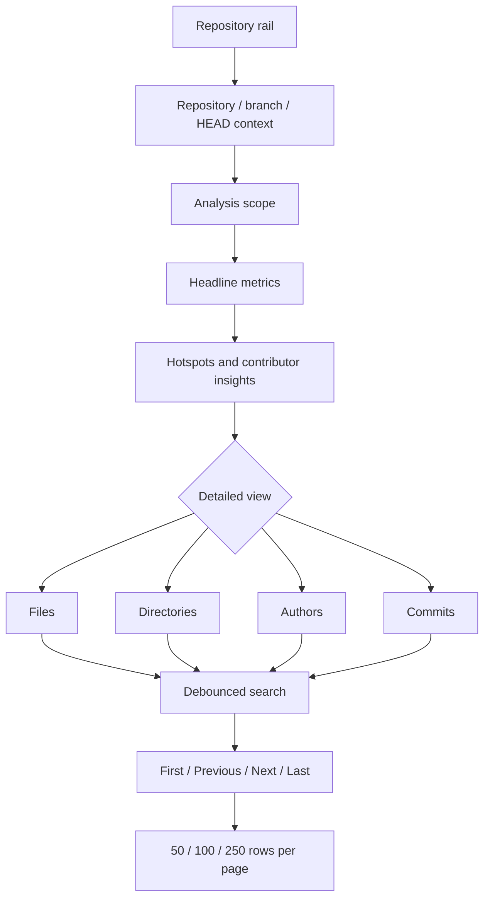
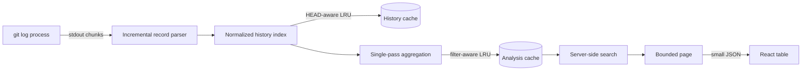

# RAT Usability and 100k-Commit Scale Design

> Assessment focus: **excellent navigation and good performance on repositories with approximately 100,000 commits**.

## 1. What “usable at 100k commits” means

Commit count alone does not determine cost: a 100,000-commit repository with one changed file per commit is smaller than one with hundreds of changed files per commit. RAT therefore treats scale as four separate risks:

1. **History extraction** must not require one giant buffered command result.
2. **Computation** should be linear in the history/change volume and reused when possible.
3. **API responses** must remain bounded even when result sets are enormous.
4. **Browser rendering** must remain bounded and navigable.

The implementation addresses all four rather than relying on a fast development machine to hide an unbounded design.

## 2. Navigation model



### Navigation strengths

- A persistent repository rail keeps every imported repository one action away.
- Repository name, branch and short `HEAD` establish context before metrics are read.
- The selected/total commit count makes filtered scope explicit.
- Four object-oriented tabs match the assessment's file, directory, author and commit-set perspectives.
- Each tab reports its result count.
- Search is scoped to the active view, avoiding ambiguous global results.
- Pagination provides first, previous, next and last actions plus an exact page indicator.
- Page-size controls let users choose between scan speed and information density.
- Sticky table headers retain column meaning during vertical exploration.
- CSV export preserves the visible evidence for external inspection.

## 3. Large-history processing pipeline



### 3.1 Streaming Git output

The server uses `spawn` and consumes Git stdout incrementally. Complete commit records are parsed as delimiters arrive, so the raw `git log --numstat` output is never duplicated as one potentially gigabyte-sized string.

This removes the fixed `maxBuffer` failure mode that commonly affects child-process helpers on large histories. The parsed history still exists in memory because arbitrary interactive filters need it, but transient raw-output memory is bounded approximately by the largest uncompleted commit record rather than the entire command output.

### 3.2 One authoritative extraction

Git is called once per imported `HEAD`. The command supplies commit metadata, `.mailmap` identities, 50% rename detection and text-file `numstat` values together. RAT does not spawn Git once per commit, file or metric.

### 3.3 Pre-indexed reusable metadata

When history is loaded, RAT builds reusable indexes once:

- unique author identities;
- sorted file paths;
- recursive directory paths;
- cached ancestor lists for each unique file path;
- repository date range.

This eliminates a repeated full-history catalog scan on every table navigation request.

### 3.4 Bounded LRU caches

RAT keeps recently used parsed histories and filtered analysis snapshots in bounded least-recently-used maps. The default limit is two entries for each cache, configurable through:

```text
RAT_HISTORY_CACHE_SIZE
RAT_ANALYSIS_CACHE_SIZE
```

The history key is repository identity plus `HEAD`; the analysis key additionally includes aliases and normalized filters. Page number, page size and table search are deliberately excluded, so moving through pages reuses the same computed snapshot.

Bounded caches provide fast interaction without allowing every repository/filter combination to remain in memory indefinitely.

### 3.5 Server-side pagination

The analysis API returns only bounded slices for files, directories, authors and commits. Accepted page sizes are clamped to `25–250` rows. Every view includes:

- current page;
- page size;
- filtered result count;
- total pages.

Insight charts receive only the top six files and authors. Path suggestions are capped (500 by default), while the filter remains a free searchable input so an exact path outside the suggestion list can still be entered.

### 3.6 Server-side search

Search runs against the already cached analysis snapshot and then paginates the match set. Searchable fields are appropriate to each object:

| View | Search fields |
|---|---|
| Files/directories | Path |
| Authors | Name and email |
| Commits | Full hash, author, email and subject |

The browser debounces input for 250 ms, preventing a request for every keystroke.

### 3.7 Scalable commit selection

Specific commits are entered as comma- or whitespace-separated SHA prefixes. This avoids rendering a 100,000-option control and permits direct selection of any commit, including commits outside the current table page.

## 4. Browser rendering strategy

The browser renders at most 250 rows for the active table and bounded first pages for inactive views. It never creates a DOM node for every commit or file in the repository.

When a user changes a page, tab or search:

1. the existing dashboard remains visible;
2. an inline “Updating view…” indicator appears;
3. stale requests are ignored if a newer navigation request wins;
4. the new bounded page replaces the old rows.

Keeping the previous result visible avoids full-page flicker and maintains spatial context during fast exploration.

## 5. Complexity and bounds

Let `C` be commits, `F` text-file change records, `D` average path depth and `O` aggregate objects.

| Operation | Time | Bound/space behavior |
|---|---:|---|
| Stream and parse first history load | `O(C + F)` | No whole-output string buffer |
| Build path/identity index | `O(C + F × D)` | Once per cached `HEAD` |
| Build a filtered snapshot | `O(C + F_selected × D + O log O)` | Reused across navigation |
| Search one result category | `O(O)` | Operates server-side |
| Return a page | `O(pageSize)` | Maximum 250 rows/category |
| Render active table | `O(pageSize)` | Maximum 250 body rows |

The first analysis remains proportional to real repository history, as any exact analyzer must read the changes it reports. The important usability property is that subsequent navigation is bounded and does not repeat Git extraction or metric aggregation.

## 6. Deterministic 100,000-commit test

`server/metrics.test.ts` includes an always-on synthetic scale test with:

- 100,000 commits;
- 50 authors;
- 1,000 rotating file paths across 100 packages;
- additions and removals on every commit;
- a request for page 400 at 250 rows per page.

It verifies:

- all 100,000 commits contribute to totals;
- pagination reports 100,000 commit results;
- the requested page contains exactly 250 rows;
- the serialized paginated response remains below 1 MB;
- analysis completes inside a conservative 15-second guard.

Latest local test observation:

```text
100,000-commit synthetic analysis: approximately 0.7 seconds
Paginated response requirement: below 1 MB
Test suite: 5 passed, 0 failed
```

This benchmark deliberately measures deterministic parsing/indexing-independent aggregation and response shaping. Real first-load time also includes Git traversal and varies with disk speed, repository packing, path depth and changes per commit. Streaming prevents that variable workload from becoming an output-buffer crash, while caching ensures it is not repeated during normal navigation.

Run the evidence yourself:

```bash
npm test
npm run build
```

## 7. Usability details

### Clear system status

- Empty, loading, updating, no-data and error states are visually distinct.
- Import buttons disable during long-running work.
- “Walking Git history” explains initial computation.
- “Updating view…” distinguishes lightweight navigation from initial analysis.
- The sidebar reports that the Git engine is ready.

### Error prevention and recovery

- Destructive repository removal requires confirmation.
- URL and ZIP ingestion modes are explicit.
- Filters use drafts and only execute when Apply is selected.
- Reset restores the complete repository scope.
- Filter count remains visible when the panel is closed.

### Responsive use

- Desktop uses a stable repository rail and two-column insights.
- Tablet reflows metric and filter grids.
- Mobile moves repositories into horizontal navigation and stacks analytical panels.
- Wide tables scroll horizontally instead of silently dropping required columns.
- Pagination controls remain horizontally reachable on narrow screens.

### Keyboard and semantic navigation

- Native buttons, inputs and selects retain keyboard behavior.
- Analysis tabs expose `tablist`, `tab` and `aria-selected` semantics.
- Repository navigation has an accessible label.
- Focus-visible outlines make keyboard location clear.
- Charts always include exact text values, and color is not the sole signal.

## 8. Requirement evidence matrix

| PDF criterion | Implemented evidence |
|---|---|
| Excellent navigation | Persistent repository navigation, context header, scope indicator, object tabs, counts, search, page sizing, first/previous/next/last controls, responsive layouts |
| Good large-repository performance | Streaming Git parser, one Git command per `HEAD`, cached indexes, cached filtered snapshots, bounded LRU eviction, server-side search and pagination |
| Approximately 100,000 commits | Always-on 100k synthetic test with exact totals, bounded 250-row page, sub-1-MB payload assertion and 15-second guard |
| Responsive feedback | Initial and incremental loading states, disabled busy actions, stale-request cancellation, localized errors |
| Discoverable analysis | Headline cards, hotspot/contributor rankings, detailed tables and CSV export |

## 9. Deliberate limits

- Cache contents are process-local and are rebuilt after restart.
- First analysis must still traverse the repository's actual history.
- A repository with unusually high changes per commit can require substantially more work than the synthetic baseline.
- Path suggestions are capped for payload safety, but direct exact-path entry remains available.
- CSV export currently exports the visible page, preventing accidental creation of a huge browser-side file.

These limits are surfaced rather than hidden. They preserve a dependable single-machine application while leaving a clear path to background jobs, disk-backed indexes and streaming exports if RAT becomes a multi-user service.